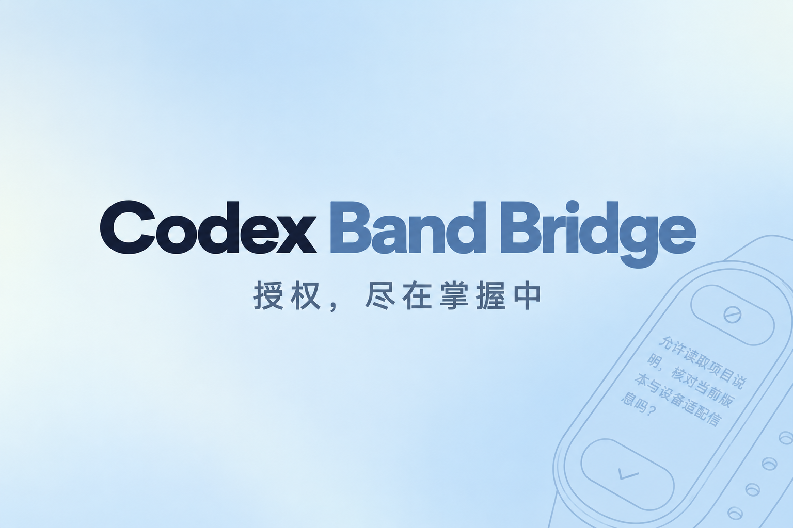
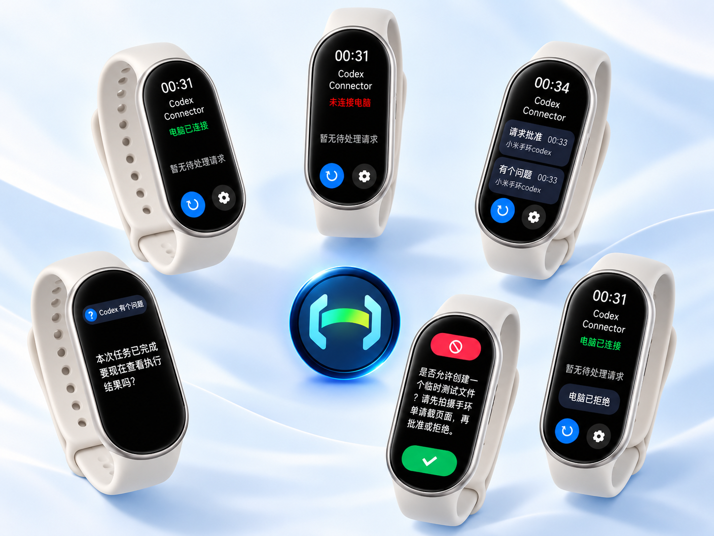

# Codex Band Connector

在小米手环 11 查看 Codex 授权请求，与电脑同步批准或拒绝。问题回答仍在电脑完成。

当前版本 **1.3.1 / 13001**，更新日期2026年10月15日。



## 下载与安装

[下载 1.3.1](https://github.com/DecafDoppio/Codex-Band-Connector/releases/tag/v1.3.1) · [全部 Releases](https://github.com/DecafDoppio/Codex-Band-Connector/releases)

##适配情况
初版1.3.1仅开放适配小米手环11及11NFC，开发者给自己加了鸡腿腿腿儿，这两周会陆续上线适配其他手环/手表型号的更新。

## 使用方法
下载 Release 中的 RPK，通过 AstroBox 安装到小米手环 11。真机已验证：手环 11（xmb11），固件 4.100.139；保持应用前台运行。问题在手环展示，回答在电脑完成。

配套项目：[Codex Band Bridge](https://github.com/DecafDoppio/Codex-Band-Bridge)。两侧均使用 1.3.1，不新增强制捆绑安装。

## 界面展示



展示看板版，含演示内容与合成场景；素材来源见 [MEDIA_SOURCES.md](MEDIA_SOURCES.md)。

## 从源码构建

Node 24.19.0、aiot-toolkit 2.0.5（package-lock.json 锁定）：

```powershell
npm ci
npm run build
```

普通 build 生成调试包。官方发布包沿用现有签名身份，签名文件须置于仓库之外：

```powershell
$env:CODEX_BAND_SIGN_KEY = '外部正式私钥绝对路径'
$env:CODEX_BAND_SIGN_CERT = '外部正式证书绝对路径'
npm run release
```

输出 dist/codex-band-1.3.1-source.rpk；dist、build、node_modules 均不提交。构建不读取历史 RPK。src/manifest.json 保留还原基线的内部元数据，release.json 指定发布版本 1.3.1/13001；不要手动统一这些内部字段。

这是可独立编译的还原 UX/JS 源码，不冒称找回原始手写源码。官方同身份签名需要维护者持有的私钥；普通用户可构建调试包。

## 发布、验证与反馈

main 保存源码及构建输入；安装包放 GitHub Releases，AstroBox 所需文件使用独立发布分支，见 [PUBLISHING.md](PUBLISHING.md)。首次推送前下载链接尚未生效。

检查结果及限制见 [VALIDATION.md](VALIDATION.md)。通过 [Issues](https://github.com/DecafDoppio/Codex-Band-Connector/issues) 反馈。自有代码采用 [MIT](LICENSE)，第三方许可证与通知保留，见 [THIRD_PARTY_NOTICES.md](THIRD_PARTY_NOTICES.md)。

社区项目，与 OpenAI、AstroBox 和小米官方无隶属关系。
