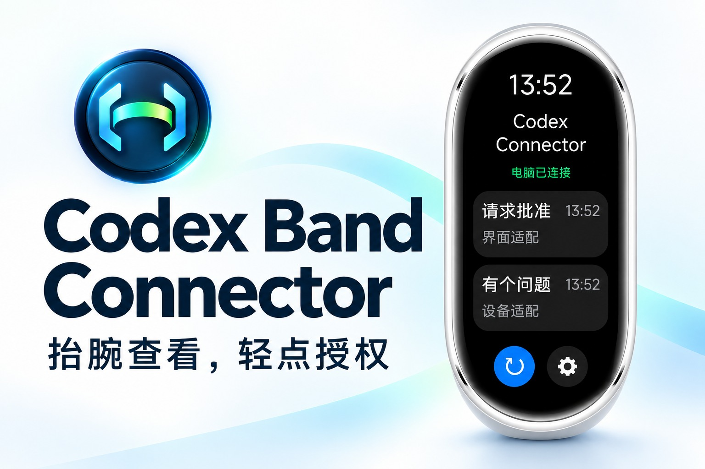
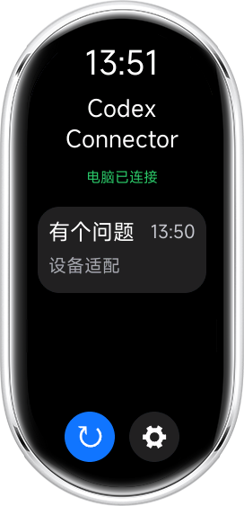
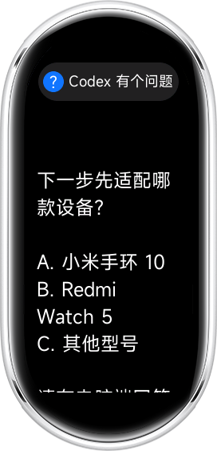

# Codex Band Connector — AstroBox distribution 1.3.1

抬腕查看，轻点授权。配合 Codex Band Bridge，在小米手环 11 查看授权请求、同步批准或拒绝，并显示多条请求队列；问题回答仍在电脑完成。

源码与构建说明：https://github.com/DecafDoppio/Codex-Band-Connector/tree/main

本次审核修正源码提交：`149081ebff40cedbc5a02b28adfc9cbb56dfe4f0`。版本仍为 1.3.1 / 13001，RPK 使用标准 aiot release 和原签名身份生成。旧包的真机验收记录不等于本次重打包已完成真机复验。第 3 项 CreatorConsole 提交由维护者手动完成，平台状态以官方审核为准。

设备声明：小米手环 11 与 11 NFC；已记录的真机验收为普通手环 11、固件 4.100.139，NFC 支持由维护者确认。

GitHub Release：https://github.com/DecafDoppio/Codex-Band-Connector/releases/tag/v1.3.1

## 界面展示

以下为 AIoT 模拟器中实际运行的界面，包含模拟器设备外壳。授权与问题内容为截图测试样例，问题仍在电脑端回答。

<table>
  <tr><th>单条授权</th><th>授权详情</th><th>多条授权</th></tr>
  <tr>
    <td></td>
    <td></td>
    <td></td>
  </tr>
  <tr><th>有个问题</th><th>问题详情</th><th>授权与问题并列</th></tr>
  <tr>
    <td></td>
    <td></td>
    <td></td>
  </tr>
</table>

截图来自 1.3.1 独立测试副本，保留正式界面与业务逻辑，仅适配模拟器通信；不作为真机互联验收。素材来源见 [素材来源](https://github.com/DecafDoppio/Codex-Band-Connector/blob/main/MEDIA_SOURCES.md)。
